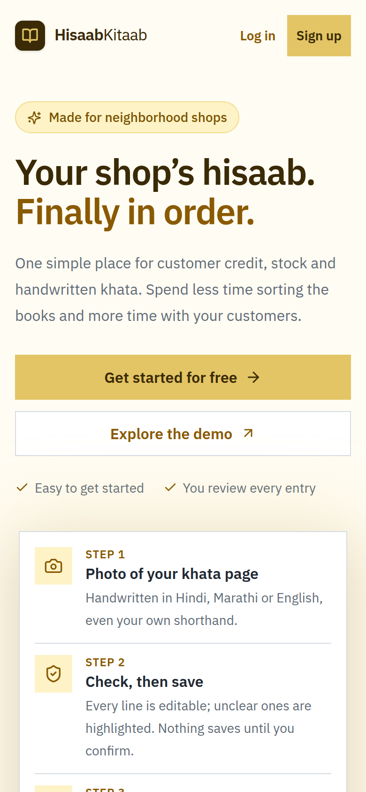
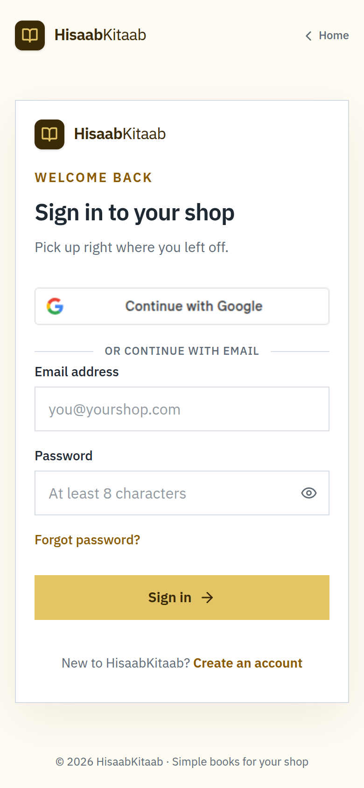
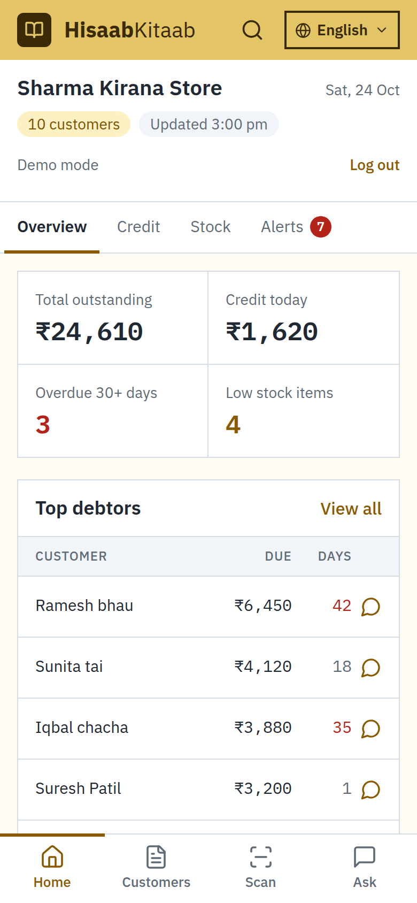
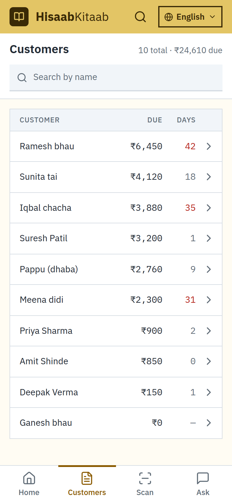
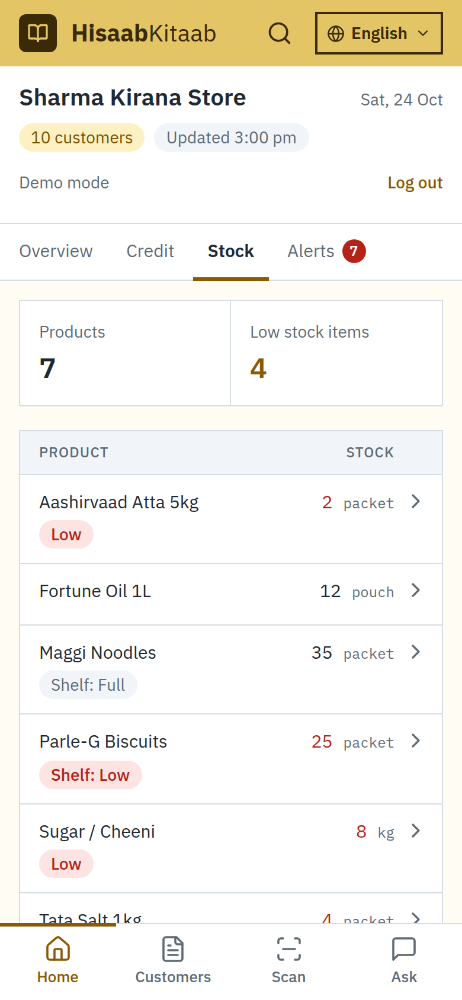
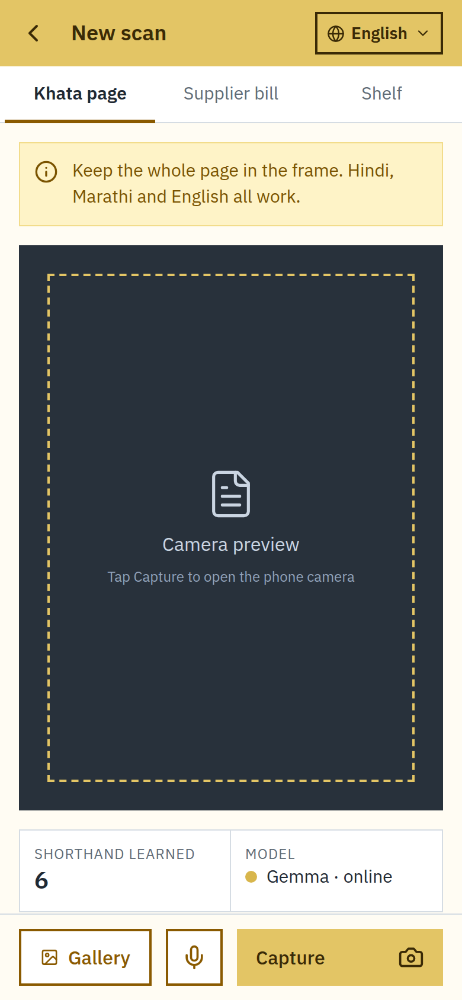
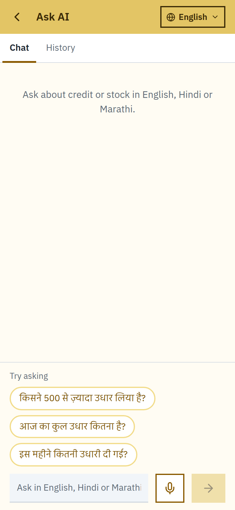

# HisaabKitaab 📒

**Your kirana shop's khata, digital without retyping.**

Kirana stores keep udhaar (credit) in a paper khata, in Hindi, Marathi or English, using their own shorthand.
HisaabKitaab lets the shopkeeper keep writing on paper and just take a photo. **Gemma** (vision + text) reads khata
pages, supplier bills and shelf photos and turns them into udhaar and stock records. The shopkeeper reviews every
row before it's saved, can ask questions in Hindi, Marathi or Hinglish, and sends WhatsApp reminders.

> **Gemma reads, code decides.** Every total, balance and alert is calculated in plain Python, never by the AI.

## Screenshots

| Landing | Sign in | Home |
|---|---|---|
|  |  |  |
| **Customers** | **Stock** | **Scan khata / bill / shelf** |
|  |  |  |
| **Ask (Pucho)** | | |
|  | | |

## Key features

- 📸 **Khata photo → udhaar entries.** Handwritten Hindi/Marathi/English lines become editable rows; unclear rows are highlighted.
- 🧾 **Supplier bill → stock.** Items, quantities and rates are read; code re-checks the totals and flags mismatches.
- 🛒 **Shelf photo → low/medium/full** stock alerts (never fake counts).
- 🗣️ **Ask in your language.** "Aaj ka total udhaar kitna hai?" Answers come from whitelisted queries on your own data, never AI-written SQL.
- 🎤 **Voice entry.** "Ramesh ko 500 udhaar diya" becomes a row on the review screen.
- 🧠 **Learns your shorthand.** Correct "Rmsh" → "Ramesh bhau" once and it's remembered; fuzzy matching and duplicate merge.
- 💬 **WhatsApp reminders**, overdue alerts (30+ days), top debtors, per-customer ledger with source photos.
- 🌐 **English / Hindi / Marathi / Hinglish UI**, mobile-first PWA, Google sign-in or demo mode.

## Tech stack

| Layer | Tech |
|---|---|
| Frontend | React + TypeScript + Vite + Tailwind (mobile-first PWA) |
| Backend | FastAPI + SQLModel (SQLite, Postgres-ready) |
| AI | Gemma 4 via Google AI Studio, or Gemma 3 locally via Ollama |
| Auth | Google Identity Services (ID token verified on the backend) |

```
/backend    FastAPI + SQLModel (SQLite) + Gemma service
/frontend   React + TypeScript + Tailwind (mobile-first PWA)
/docs       Guides and screenshots
/samples    Sample khata pages, bill and shelf photos
```

More: [docs/demo.md](docs/demo.md) (full setup + troubleshooting) · [docs/ARCHITECTURE.md](docs/ARCHITECTURE.md)
· [docs/DEMO_SCRIPT.md](docs/DEMO_SCRIPT.md) · [docs/OFFLINE.md](docs/OFFLINE.md)

## Prerequisites

- Python 3.11+
- Node 20+
- One of:
  - a **Google AI Studio** API key (https://aistudio.google.com/apikey), or
  - **Ollama** running locally with a vision Gemma model: `ollama pull gemma3:4b`

## Run the project

**1. Backend** (terminal 1)

```bash
cd backend
python3 -m venv .venv
source .venv/bin/activate
pip install -r requirements.txt
cp .env.example .env          # set GOOGLE_API_KEY (or AI_PROVIDER=ollama) and GOOGLE_OAUTH_CLIENT_ID
python -m scripts.seed_demo   # optional: realistic demo data
uvicorn app.main:app --reload --port 8000
```

The SQLite database is created at `backend/data/hisaabkitaab.db` on first start. API docs: http://localhost:8000/docs

**2. Frontend** (terminal 2)

```bash
cd frontend
npm install
npm run dev -- --host         # laptop: http://localhost:5173
```

The Vite dev server proxies `/api` and `/uploads` to the backend, so the phone never calls port 8000 directly.

**3. On your phone (same Wi-Fi)** (terminal 3)

```bash
cd frontend
npm run dev:https             # https on port 5174 (needed for Google sign-in, camera preview, mic)
```

1. Find the laptop IP: `hostname -I` (e.g. `192.168.1.23`).
2. Open **`https://192-168-1-23.nip.io:5174`** on the phone (IP with dashes), tap *Advanced → Proceed* on the certificate warning.
3. Plain `http://192.168.1.23:5173` also works for data, but Google only allows sign-in on `localhost` or https.

**Phone checklist (if data or sign-in doesn't work):**

| Problem | Fix |
|---|---|
| Page/data doesn't load on the phone | Allow the ports through the laptop firewall: `sudo ufw allow 5173/tcp && sudo ufw allow 5174/tcp`. Same Wi-Fi, not a guest network. |
| Google: "origin is not allowed" / button does nothing | Google Cloud Console → Credentials → your OAuth Web client → **Authorized JavaScript origins** → add `https://<ip-with-dashes>.nip.io:5174` (and `http://localhost:5173`). Wait ~5 min. Re-add if the laptop IP changes. |
| nip.io link doesn't open | Some routers/Private DNS block it; turn off Android *Private DNS* or use mobile hotspot from the laptop. |

## Health checks

| Endpoint | What it checks |
| --- | --- |
| `GET /api/health` | API is up and the database answers |
| `GET /api/health/ai` | Gemma provider is reachable and the model exists |
| `GET /api/health/ai?deep=true` | Also runs a tiny JSON generation through Gemma |

The home screen shows all three.

## Features

### Snap khata → udhaar entries (Phase 1)

1. **Scan** (bottom nav or "Scan khata page") → live camera preview where the browser
   allows it (localhost / https), otherwise the phone's camera app; or pick from Gallery.
   The photo is shrunk to 1600px on the phone before upload.
2. Gemma reads each line: customer name, amount, gave/got, date, raw text, confidence.
   Devanagari digits and "₹1,200/-" style amounts are cleaned up in code, and rows
   with a missing name, zero/huge amount or paise are forced to low confidence.
3. **Review entries**: every row shows what was read ("Read as: …") and is editable;
   low-confidence rows are orange, with a "Needs review" filter. Only rows you
   confirm are saved.
4. **Home**: total outstanding, udhaar today, overdue (30+ days without a payment),
   top debtors. **Customers**: searchable list. **Customer**: balance, last payment,
   ledger with running balance, source photos, "+ Entry" for manual entries and a
   prefilled WhatsApp reminder.

API: `POST /api/khata/extract` (photo → rows, nothing saved), `POST /api/khata/confirm`,
`GET /api/overview`, `GET /api/customers`, `GET /api/customers/{id}/ledger`.

### Ask in Hindi/Marathi/Hinglish (Phase 3 – Poocho)

Use the Poocho tab to ask natural language questions about customer balances, totals, and low stock. The backend validates a structured intent and runs only whitelisted Python queries against the database; model output is never executed as SQL.

Run the sample suite with `cd backend` then `python -m scripts.test_poocho`.

### Supplier Bill + Shelf → Stock (Phase 2)

1. **Scan** tab → select **Supplier Bill** mode:
   - Photograph a printed or handwritten supplier bill / wholesaler parcha.
   - Gemma extracts supplier name, bill date, items, quantities, units, rates, and totals.
   - Ordinary Python logic verifies `quantity × rate = line_total` and compares sum of items against stated bill total.
   - Any total mismatch is flagged with a warning banner; low confidence rows are highlighted in yellow.
   - Explainable fuzzy matching suggests existing product candidates with match percentages (e.g. `Tata Salt (85% match)`) or allows creating a new product.
   - On confirmation, an atomic database transaction creates `SupplierBill` and `StockEntry` (kind=`purchase`) records.
   - Idempotency token prevents double-adding stock on duplicate confirmation.
2. **Scan** tab → select **Shelf Photo** mode:
   - Take a photo of a shelf, rack, or display tray.
   - Gemma visually assesses stock fullness returning strictly `low`, `medium`, or `full` with visual evidence and uncertainty notes (never claims exact inventory counts).
   - Confirmation saves a `StockEntry` with kind=`shelf_check` and `qty_change = 0`, keeping recorded inventory quantities accurate while displaying visual shelf alerts.
3. **Stock** tab:
   - Search products, view current counted stock balances, latest supplier bill additions, and visual shelf status tags (`SHELF: LOW` in yellow/rose).
   - Tap any product to view its complete chronological stock and shelf check history.

API endpoints:
- `POST /api/stock/bills/extract` (bill photo → items, line totals, total mismatch check, fuzzy product matches)
- `POST /api/stock/bills/confirm` (idempotent, atomic transaction creating stock entries)
- `POST /api/stock/shelf/assess` (shelf photo → low/medium/full status, visual evidence)
- `POST /api/stock/shelf/confirm` (saves visual check with zero quantity change)
- `GET /api/stock/products` (list products with stock balance, shelf status, and update source)
- `GET /api/stock/products/{id}/history` (audit history of purchases and shelf checks)

#### Running Backend Tests

```bash
cd backend
PYTHONPATH=. .venv/bin/pytest tests/ -v
```

Tests verify all 10 Phase 2 requirements (mocked Gemma responses, retry logic, mismatch detection, editable values, fuzzy matching, stock additions, idempotency, transaction rollback, qualitative shelf status, and Phase 1 preservation).

### Learns the shop's handwriting (Phase 5)

1. **Correct once, remembered after.** On Review entries, change a name the AI read as written
   (e.g. "Rmsh" → "Ramesh bhau") and confirm. The app stores `Rmsh = Ramesh bhau` in `ShorthandMap`.
   The card shows "Save karne par yaad rakhenge: …" before you save. Linking a bill item to an existing
   product does the same for items ("ch" = Sugar / Cheeni).
2. **Used on the next photo.** The khata prompt includes the shop's customers and learned shorthand
   (the bill prompt gets products and item shorthand). Code then resolves each name in this order:
   learned shorthand → the model's pick from the customer list → fuzzy match. Auto-filled names
   show why, e.g. "Rmsh → Ramesh bhau · seekha hua".
3. **Fuzzy names** (`app/services/names.py`): ignores honorifics (bhau, tai, didi, ji, भाऊ, ताई…),
   matches abbreviations by consonants ("Rmsh" ↔ "Ramesh"), and doesn't guess when two customers
   match equally ("Ramesh Patil" vs "Ramesh Kumar").
4. **Merge duplicates.** A customer's page lists likely duplicates with a **Jodo** button. Merging moves
   the entries and remembers the old name as shorthand.

API: `GET /api/customers/{id}/similar`, `POST /api/customers/{id}/merge` (`{"from_id": …}`);
`POST /api/khata/confirm` accepts `written_name` per row and returns `learned`.
Tests: `tests/test_phase5.py` (includes "correct an entry, re-upload a similar page, it's now right").

### Voice + demo polish (Phase 6)

- **Voice entry:** 🎤 on the khata scan screen. Say or type "Ramesh ko 500 udhaar diya, Sunita ne 200 jama kiye";
  Gemma turns it into rows on the same Review screen (learned shorthand and name matching apply, numbers in
  words like "paanch sau" / "dedh hazaar" work). **+ Entry** on a customer page has a "Bol kar bharein" mic too.
  `POST /api/khata/voice` (`{"text": …}`), nothing is saved until you confirm.
- **Spoken questions:** the mic in Pucho sends the question as soon as you stop speaking.
- **Language dropdown** in the header: English, Hindi, Marathi, Hinglish across every screen (`frontend/src/lib/i18n.tsx`, `translations.ts`), remembered per device.
- **Loading states:** grey placeholders while data loads instead of empty/zero values.
- **Seed data:** `python -m scripts.seed_demo` (see [docs/demo.md](docs/demo.md#6-demo-data-optional)); refuses to
  wipe a database with customers unless `--yes`.
- Tests: `tests/test_phase6.py`.

### Offline path (Phase 7, stretch)

Design for running a small Gemma on the phone with no internet, plus a benchmark that measures any provider on
the same test set (`samples/khata`, the sample bill, `samples/voice.json`):

```bash
cd backend && python -m scripts.bench_offline                                      # cloud
cd backend && python -m scripts.bench_offline --provider ollama --model gemma3:4b  # local
```

Results and the Android plan: [docs/OFFLINE.md](docs/OFFLINE.md).

## Switching the AI provider

All model calls go through `backend/app/services/gemma.py`. Set `AI_PROVIDER` in
`backend/.env`:

- `google`: Google AI Studio (`GOOGLE_MODEL`, default `gemma-3-27b-it`)
- `ollama`: local Ollama (`OLLAMA_MODEL`, default `gemma3:4b`)

Every structured model output is validated with Pydantic. If the JSON is invalid,
the service retries once with the error message, then returns a clear error.
